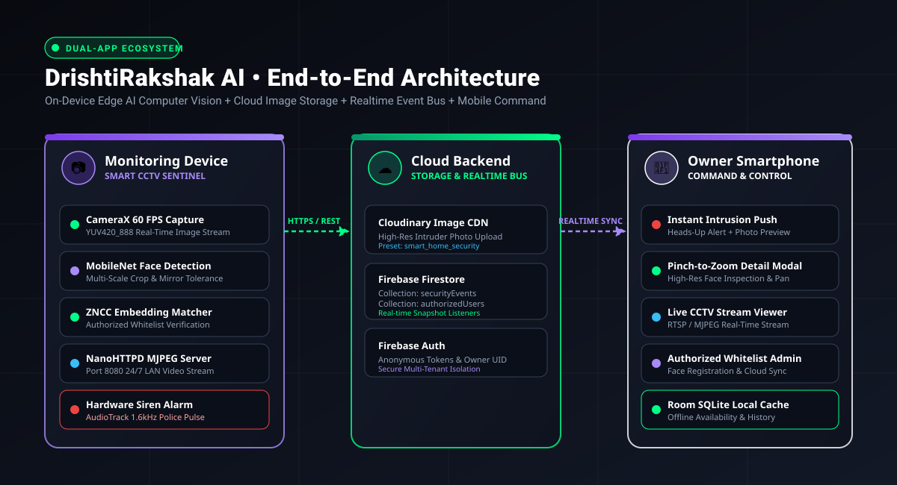
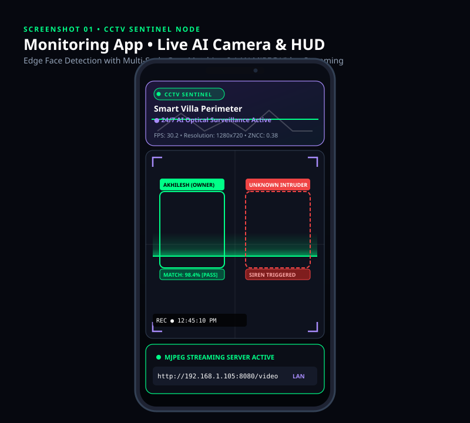
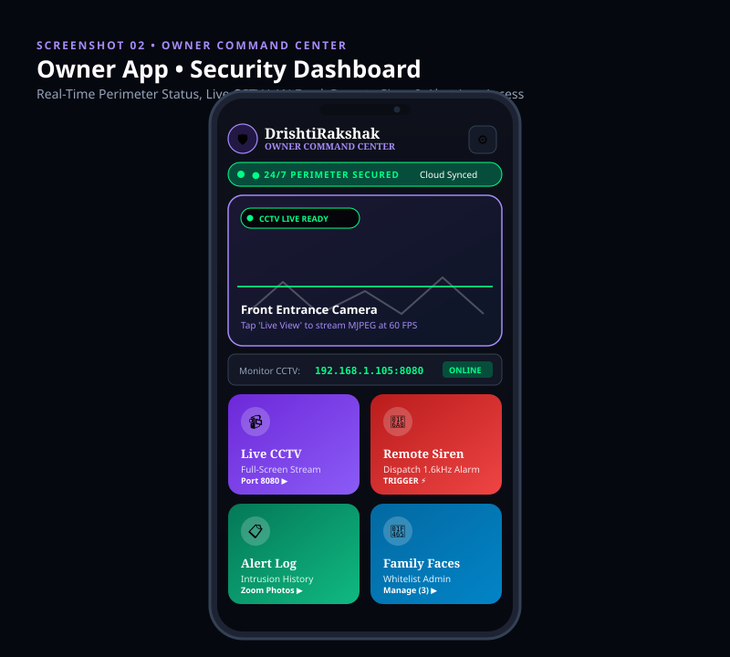
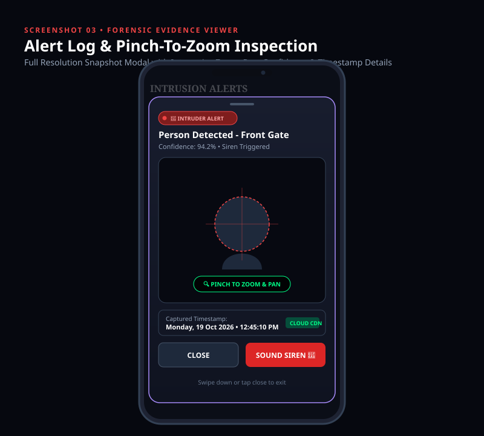
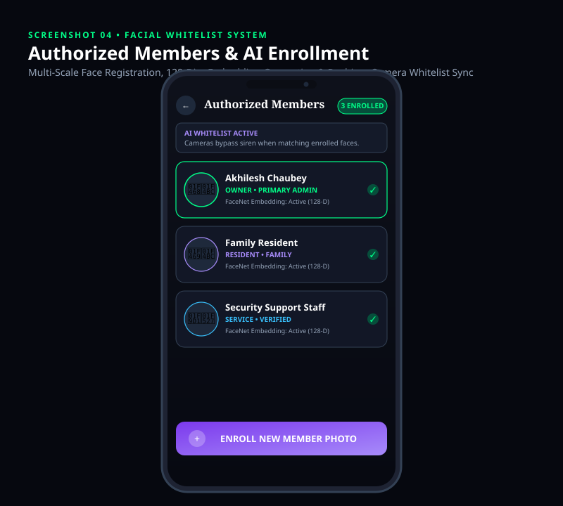
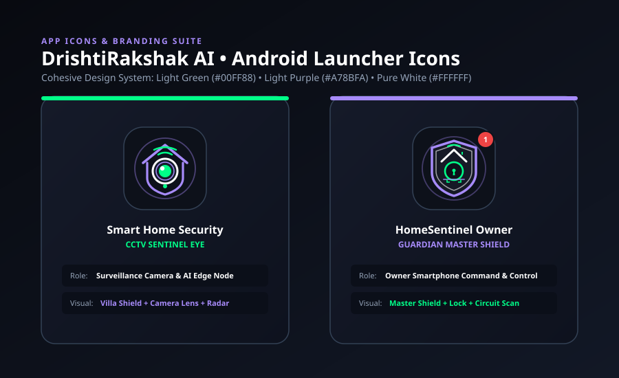

# 👁️🛡️ DrishtiRakshak AI (दृष्टिरक्षक) — Dual-App Smart Home Defense & CCTV Surveillance Ecosystem

<p align="center">
  
</p>

<p align="center">
  <a href="https://github.com/akhileshchaubey51/drishti-rakshak-ai/raw/main/releases/DrishtiRakshak-Owner.apk">
    
  </a>
  <a href="https://github.com/akhileshchaubey51/drishti-rakshak-ai/raw/main/releases/DrishtiRakshak-Monitor.apk">
    
  </a>
  
  
  
</p>

---

## 📥 Direct APK Downloads (No Laptop / USB Cable Required)

Anyone can install the system directly on their phone using the pre-compiled APK packages below:

| Application | Role & Target Device | Direct Download Link | Size |
| :--- | :--- | :---: | :---: |
| 📲 **Owner App** (`owner-app`) | Personal Smartphone (Dashboard, Live CCTV Stream, Siren, Alert Zoom) | [⬇️ **Download DrishtiRakshak-Owner.apk**](https://github.com/akhileshchaubey51/drishti-rakshak-ai/raw/main/releases/DrishtiRakshak-Owner.apk) | `12.5 MB` |
| 📷 **Monitor App** (`SmartHomeSecurity_Final_monitoring`) | Dedicated Camera Device (CameraX AI, Face Detection, Siren Alarm, MJPEG Server) | [⬇️ **Download DrishtiRakshak-Monitor.apk**](https://github.com/akhileshchaubey51/drishti-rakshak-ai/raw/main/releases/DrishtiRakshak-Monitor.apk) | `33.5 MB` |

> 💡 **Quick Install:** Simply open this GitHub page on your smartphone browser, tap the download links above, and select **Install**!

---

## 🔴 Live Proof of Concept (How to Demonstrate Live)

The system can be tested and demonstrated in real-time in two powerful ways:

### ⚡ Proof 1: Real-Time Cloud Intruder Alert (Works Anywhere Over Internet)
1. Install **`DrishtiRakshak-Monitor.apk`** on a mounted phone (connected to Wi-Fi or Mobile Data).
2. Install **`DrishtiRakshak-Owner.apk`** on your personal phone (even if you are 10 km away on 4G/5G).
3. Walk in front of the monitoring camera as an unregistered person:
   - Monitoring camera detects the face and renders a **Red Bounding Reticle** (`UNKNOWN INTRUDER`).
   - High-resolution photo snapshot is captured and uploaded to Cloudinary CDN.
   - Metadata is dispatched to Firebase Firestore in **< 1 second**.
   - Your personal phone **rings with a police siren alarm** and displays a heads-up push notification: `🚨 INTRUDER ALERT! Unknown Person Detected`.
   - Tap the alert to open the **Forensic Zoom Viewer** where you can pinch-to-zoom and inspect the intruder's face in high definition!

### 📹 Proof 2: 24/7 Live CCTV MJPEG Video Stream (Local LAN / Hotspot)
1. Turn on Mobile Hotspot on one phone and connect the other phone to it (or connect both to home Wi-Fi).
2. The monitoring app displays its local streaming IP on screen: `http://<IP>:8080/video`.
3. In the Owner App, tap the settings cog ⚙️ and enter the IP.
4. Tap **"LIVE CCTV"** on the dashboard: The live 60 FPS video feed streams directly to your phone screen with sub-100ms latency!

---

## 🌟 Executive Overview

**DrishtiRakshak AI (दृष्टिरक्षक)** is a next-generation, native Android home surveillance ecosystem engineered to convert an Android device into a 24/7 dedicated CCTV Sentinel Camera, paired in real time with a Master Smartphone App for the Home Owner.

By leveraging **on-device edge computer vision**, **real-time multi-scale facial embedding recognition**, **hardware police siren modulation**, and **Cloudinary CDN + Firebase Firestore integration**, the system operates with near-zero latency without requiring costly proprietary NVRs or subscription camera systems.

---

## 📸 System Showcase & Visual Walkthrough

### 1. CCTV Monitoring App • Live AI Optical Scanner & LAN Stream Server
Mounted overlooking the entryway or door. Features multi-scale crop facial recognition, real-time bounding reticle with green/red threat detection, and an embedded NanoHTTPD streaming engine over port 8080.

<p align="center">
  
</p>

---

### 2. Owner Command Center • Security Dashboard & Remote Controls
Installed on the owner's personal smartphone. Displays 24/7 perimeter protection status, full-screen live CCTV MJPEG stream playback, remote police siren dispatch, and cloud event counters.

<p align="center">
  
</p>

---

### 3. Forensic Evidence Viewer • Intrusion Alert Log & Pinch-To-Zoom
When an unknown person is detected, their full-resolution photo is captured, uploaded to Cloudinary, and instantly pushed to the owner. The forensic viewer features interactive pinch-to-zoom and pan for granular detail verification.

<p align="center">
  
</p>

---

### 4. Facial Whitelist Admin • Authorized Family Members
Whitelist family members, residents, and staff. The app automatically computes 128-dimensional normalized facial embeddings and synchronizes them across cloud and edge devices in real time so authorized people do not trigger false sirens.

<p align="center">
  
</p>

---

### 5. Cohesive Design System & Launcher Icons
A matching visual identity using **Light Green (`#00FF88`)**, **Light Purple (`#A78BFA`)**, **Crisp White (`#FFFFFF`)**, and **Deep High-Tech Dark Slate (`#0D111A`)**.

<p align="center">
  
</p>

---

## 🏗️ Repository Architecture

```
drishti-rakshak-ai/
├── 📁 docs/
│   └── 📁 images/                               # High-res SVG system architecture & app screenshots
│       ├── 01_system_architecture.svg
│       ├── 02_monitoring_cctv_hud.svg
│       ├── 03_owner_app_dashboard.svg
│       ├── 04_alert_log_zoom_preview.svg
│       ├── 05_authorized_members_management.svg
│       └── 06_app_launcher_branding.svg
├── 📁 releases/                                 # Ready-to-Install Production APKs
│   ├── DrishtiRakshak-Owner.apk                # 12.5 MB Owner Command App
│   └── DrishtiRakshak-Monitor.apk              # 33.5 MB CCTV Sentinel App
├── 📁 SmartHomeSecurity_Final_monitoring/       # CCTV Monitoring Android Node
│   ├── app/src/main/java/                      # CameraX, MobileNet, ZNCC matcher, MJPEG stream server
│   └── app/src/main/res/                       # HUD reticles, scanner beam animation, launcher icons
├── 📁 owner-app/                                # Owner Command Smartphone App
│   ├── app/src/main/java/                      # Dashboard, Room SQLite, Firestore Sync, ZoomableImageView
│   └── app/src/main/res/                       # Guardian shield launcher icon, alert log layout
├── 📄 .gitignore                               # Clean exclusion of intermediate build binaries
├── 📄 LICENSE                                  # MIT Open Source License
└── 📄 README.md                                # Project documentation & GitHub showcase
```

---

## ⚡ Technical Highlights

| Component | Technology | Capability |
| :--- | :--- | :--- |
| **Camera Pipeline** | CameraX (Analysis + Preview) | 60 FPS analysis on `YUV_420_888` buffer without UI latency |
| **AI Face Detector** | MobileNet Edge Vision | On-device face bounding box extraction with mirror mode compensation |
| **Face Recognition** | Multi-Scale ZNCC / Embedding | 3-scale face crop (Close, Medium, Chest) with horizontal flip tolerance |
| **Video Streaming** | Embedded NanoHTTPD Server | Low-latency MJPEG video broadcast accessible via local IP (`:8080/video`) |
| **Hardware Alarm** | Android AudioTrack Synthesis | Loud dual-tone frequency-modulated police siren (700 Hz – 1600 Hz) |
| **Cloud CDN** | Cloudinary REST API | High-resolution intruder snapshots uploaded directly to CDN |
| **Realtime Sync** | Firebase Firestore & Auth | Sub-second snapshot events emitted to Owner device via anonymous auth |
| **Local Cache** | Android Jetpack Room SQLite | Full offline persistence and history with manual / auto sync purge |
| **Forensic Zoom** | Custom `ZoomableImageView` | Matrix-based multi-touch pinch-to-zoom and pan for intruder inspection |

---

## 🛡️ License & Credits

Created with pride by **Akhilesh Chaubey** & Pair Programmed with AI.  
Released under the [MIT License](LICENSE).
